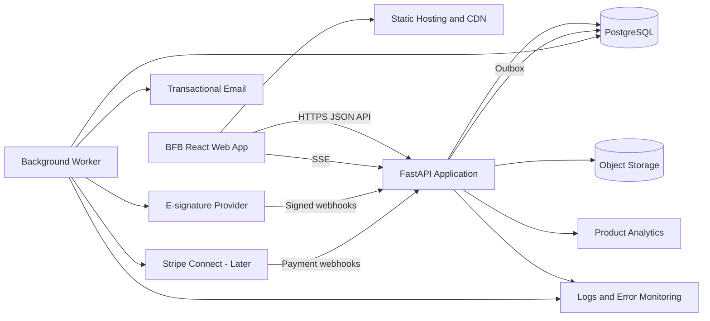
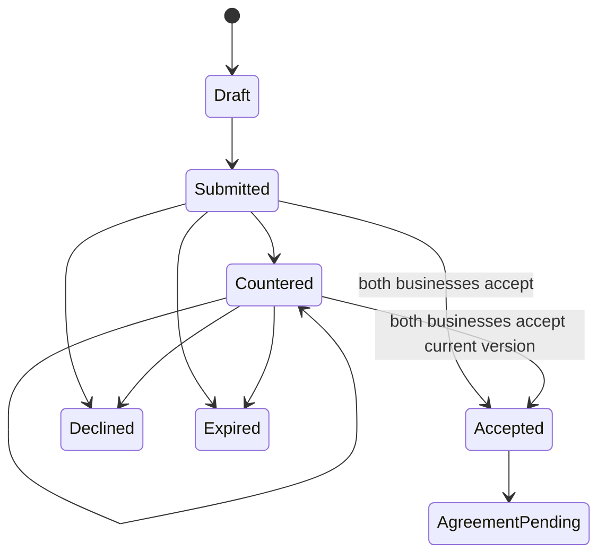
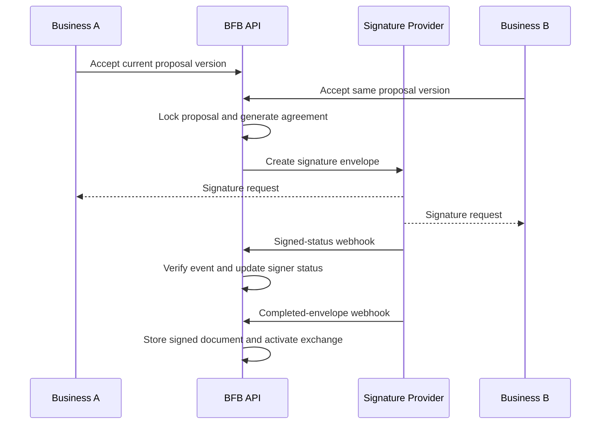
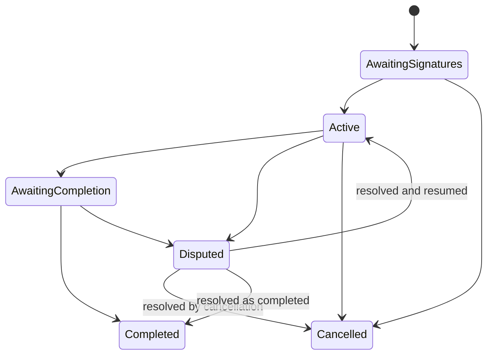

# BFB System Design

## Document purpose

This document defines the proposed production system for BFB. It translates the product and development plans into technical boundaries, data models, workflows, security requirements, integrations, and deployment architecture.

The design deliberately reuses proven RendezView architecture and implementation patterns while preserving BFB as an independent product with its own domain model and release lifecycle.

## Goals

- Support the complete path from account creation to completed service exchange.
- Keep each business's data isolated and correctly authorized.
- Preserve immutable records of proposals, agreements, signatures, and state changes.
- Support concierge operations without requiring direct database access.
- Provide reliable messages and notifications.
- Allow the system to start small and scale without an early microservice rewrite.
- Make consequential operations observable, auditable, and retry-safe.
- Keep BFB independent from RendezView at runtime.

## Non-goals for the MVP

- Internal trade currency
- BFB wallet
- BFB-operated escrow
- Multi-party exchange chains
- Fully automated tax filing
- Native mobile applications
- Complex calendar availability
- Global multi-region deployment
- Machine-learning-based matching
- Separate microservices for every domain

## Architectural principles

### Modular monolith first

The API will begin as a modular FastAPI application backed by one PostgreSQL database.

This approach provides:

- Clear transactions
- Simpler deployment
- Easier local development
- Lower operational cost
- Faster iteration
- Domain boundaries that can later be extracted if scaling requires it

Modules must communicate through services and domain events rather than importing route behavior.

### Server-authoritative workflows

The API controls:

- Authorization
- Current state
- Allowed transitions
- Proposal acceptance
- Agreement activation
- Delivery acceptance
- Completion

The frontend never determines whether an action is valid.

### Immutable consequential records

Proposal versions, signed agreements, signature evidence, state-transition logs, and audit events are immutable.

Corrections create a new version, amendment, or compensating event.

### Asynchronous side effects

Business transactions should persist an outbox event in the same database transaction. Email, realtime notification, analytics, and integration delivery occur after commit.

### Idempotent external operations

Webhook processing and retryable consequential commands must use idempotency keys and provider-event identifiers.

## High-level architecture



## Runtime components

### BFB web application

Responsibilities:

- Public landing experience
- Authentication screens
- Business onboarding
- Marketplace browsing
- Offers and needs
- Matching
- Proposal negotiation
- Agreement and signature status
- Exchange workspace
- Messaging and notifications
- Admin operations

The frontend communicates only with the BFB API and approved third-party client SDKs.

### BFB API

Responsibilities:

- Authentication and session management
- Authorization and business ownership
- Domain validation
- State transitions
- Persistence
- Search and matching
- Upload authorization
- Conversation access
- Admin commands
- Webhook validation
- Outbox event creation

### Background worker

Responsibilities:

- Email delivery
- Notification dispatch
- E-signature requests
- Retryable provider calls
- Scheduled reminders
- Expiration handling
- Search-document refresh if introduced
- Operational exports

The initial worker may run from the same codebase with a separate process type.

### PostgreSQL

Primary system of record for:

- Accounts
- Businesses
- Marketplace data
- Proposals
- Exchanges
- Conversations
- Notifications
- Agreements
- Audit events
- Integration records

### Object storage

Stores:

- Business logos
- Cover images
- Portfolio media
- Message attachments
- Delivery attachments
- Generated agreements
- Signed agreement copies

The database stores metadata and object keys, not raw file content.

## Frontend design

### Feature boundaries

```text
src/
├── app/
│   ├── router/
│   ├── providers/
│   ├── guards/
│   └── shell/
├── components/
│   ├── ui/
│   ├── layout/
│   └── feedback/
├── features/
│   ├── auth/
│   ├── onboarding/
│   ├── businesses/
│   ├── listings/
│   ├── marketplace/
│   ├── matching/
│   ├── proposals/
│   ├── agreements/
│   ├── exchanges/
│   ├── messages/
│   ├── notifications/
│   └── admin/
├── lib/
│   ├── api/
│   ├── analytics/
│   ├── uploads/
│   └── validation/
├── stores/
├── styles/
└── types/
```

### State categories

#### Server state

API resources should be fetched and invalidated predictably. A server-state library may be introduced if it reduces custom caching complexity.

#### Session state

The auth store owns:

- Current user
- Active business
- Access-token lifecycle
- Session restoration
- Logout and session reset

Long-lived refresh credentials should use secure browser storage appropriate to the final authentication design.

#### Draft state

Multi-step onboarding and proposal drafts may be held locally while in progress, but submitted records must be persisted by the API.

#### Realtime state

SSE events invalidate or update:

- Notifications
- Conversations
- Proposal status
- Agreement status
- Exchange status

Realtime events are hints to refresh state; the API remains authoritative.

## Backend module design

```text
src/
├── api/
│   ├── dependencies/
│   └── routes/
├── core/
│   ├── config.py
│   ├── database.py
│   ├── security.py
│   ├── storage.py
│   ├── errors.py
│   └── events.py
├── models/
├── schemas/
├── services/
│   ├── auth/
│   ├── businesses/
│   ├── listings/
│   ├── matching/
│   ├── proposals/
│   ├── agreements/
│   ├── exchanges/
│   ├── conversations/
│   ├── notifications/
│   └── admin/
├── integrations/
│   ├── email/
│   ├── signatures/
│   ├── storage/
│   └── stripe/
├── workers/
└── tests/
```

### Route responsibilities

Routes:

- Parse requests
- Resolve the authenticated actor
- Enforce top-level role and ownership gates
- Call services
- Map known errors to API responses
- Return schemas

Routes must not contain multi-step business transactions.

### Service responsibilities

Services:

- Load authorized domain resources
- Validate business rules
- Perform transactions
- Create state logs
- Create audit records
- Write outbox events
- Return committed results

## Core data model

### Identity

#### users

- `id`
- `email`
- `password_hash`
- `email_verified_at`
- `platform_role`
- `status`
- `terms_version`
- `privacy_version`
- `last_login_at`
- timestamps

#### refresh_sessions

- `id`
- `user_id`
- `token_hash`
- `token_family_id`
- `expires_at`
- `rotated_at`
- `revoked_at`
- device and request metadata

#### businesses

- `id`
- `legal_name`
- `display_name`
- `slug`
- `description`
- `industry`
- `stage`
- `team_size`
- `location`
- `service_area`
- `website`
- `verification_status`
- `profile_status`
- media keys
- timestamps

#### business_members

- `id`
- `business_id`
- `user_id`
- `role`
- `status`
- timestamps

Unique constraint:

```text
(business_id, user_id)
```

### Marketplace

#### service_offers

- `id`
- `business_id`
- `category_id`
- `title`
- `description`
- `deliverables`
- `value_min`
- `value_max`
- `delivery_mode`
- `capacity`
- `available_from`
- `available_until`
- `status`
- timestamps

#### business_needs

- `id`
- `business_id`
- `category_id`
- `title`
- `description`
- `desired_outcome`
- `expected_deliverables`
- `value_min`
- `value_max`
- `desired_start`
- `desired_completion`
- `delivery_mode`
- `urgency`
- `status`
- timestamps

#### portfolio_items

- `id`
- `business_id`
- `object_key`
- `media_type`
- `title`
- `description`
- `sort_order`
- timestamps

Reordering should use a batch operation to avoid partial ordering updates.

#### match_suggestions

- `id`
- `business_a_id`
- `business_b_id`
- `source`
- `status`
- `fit_band`
- `explanation`
- `expires_at`
- timestamps

#### match_components

- `id`
- `match_suggestion_id`
- `offer_id`
- `need_id`
- `direction`
- `factor_data`

### Proposals

#### exchange_proposals

- `id`
- `match_suggestion_id`
- `business_a_id`
- `business_b_id`
- `current_version_id`
- `status`
- `expires_at`
- timestamps

#### exchange_proposal_versions

- `id`
- `proposal_id`
- `version_number`
- `created_by_business_id`
- `terms_snapshot`
- `status`
- `created_at`

`terms_snapshot` may initially be structured JSON while stable fields are normalized for reporting and constraints.

Each version is immutable.

#### proposal_acceptances

- `id`
- `proposal_version_id`
- `business_id`
- `accepted_by_user_id`
- `accepted_at`

Unique constraint:

```text
(proposal_version_id, business_id)
```

A new proposal version invalidates the negotiation effect of prior acceptances.

### Agreements

#### exchange_agreements

- `id`
- `proposal_version_id`
- `document_version`
- `status`
- `unsigned_object_key`
- `signed_object_key`
- `signature_provider`
- `provider_envelope_id`
- timestamps

#### agreement_signers

- `id`
- `agreement_id`
- `business_id`
- `user_id`
- `provider_signer_id`
- `status`
- `signed_at`

#### agreement_events

- `id`
- `agreement_id`
- `provider_event_id`
- `event_type`
- `payload_hash`
- `received_at`
- `processed_at`

Provider event IDs must be unique.

### Exchanges

#### exchanges

- `id`
- `agreement_id`
- `business_a_id`
- `business_b_id`
- `status`
- `activated_at`
- `target_completion_at`
- `completed_at`
- timestamps

#### exchange_state_logs

- `id`
- `exchange_id`
- `from_status`
- `to_status`
- `actor_user_id`
- `actor_business_id`
- `reason`
- `metadata`
- `created_at`

Rows are append-only.

#### exchange_milestones

- `id`
- `exchange_id`
- `responsible_business_id`
- `recipient_business_id`
- `title`
- `description`
- `due_at`
- `sequence`
- `status`
- timestamps

#### delivery_submissions

- `id`
- `milestone_id`
- `submitted_by_user_id`
- `note`
- `submitted_at`
- `status`

#### delivery_attachments

- `id`
- `delivery_submission_id`
- `object_key`
- `filename`
- `mime_type`
- `size_bytes`

#### acceptance_decisions

- `id`
- `delivery_submission_id`
- `decided_by_user_id`
- `decision`
- `note`
- `created_at`

### Communication

#### conversations

- `id`
- optional match, proposal, or exchange association
- timestamps

#### conversation_participants

- `conversation_id`
- `business_id`
- membership metadata

#### messages

- `id`
- `conversation_id`
- `sender_user_id`
- `sender_business_id`
- `message_type`
- `body`
- `created_at`
- edited and deleted metadata where supported

#### message_attachments

- `id`
- `message_id`
- object metadata

System messages must be distinguishable from user-authored messages.

### Notifications and operations

#### notifications

- `id`
- `user_id`
- `event_type`
- `title`
- `body`
- `target_url`
- `read_at`
- timestamps

#### notification_outbox

- `id`
- `event_id`
- `event_type`
- `aggregate_type`
- `aggregate_id`
- `payload`
- `available_at`
- `processed_at`
- retry metadata

#### notification_deliveries

- `id`
- `event_id`
- `user_id`
- `channel`
- `status`
- `provider_id`
- `failure_reason`
- timestamps

#### audit_events

- `id`
- actor user and business
- impersonating administrator where applicable
- action
- resource type and ID
- request metadata
- before and after summaries where permitted
- created timestamp

## Authorization model

### Platform roles

- User
- Support
- Administrator

### Business roles

- Owner
- Administrator
- Member

### Authorization rules

Every business-scoped route must verify:

1. The user is authenticated.
2. The account is active.
3. The business exists.
4. The user has active membership in that business.
5. The membership role permits the action.
6. The resource belongs to or is shared with that business.
7. The resource's state permits the action.

Administrators use explicit admin routes. Impersonated actions must preserve the true administrator identity in audit records.

## Authentication design

### Access token

- Short lifetime
- JWT
- Contains user identity and limited platform claims
- Does not replace database authorization checks

### Refresh token

- Opaque random value
- Stored only as a secure hash
- Rotated on use
- Assigned to a token family
- Revoked on logout, password reset, account compromise, or detected reuse

### Session restoration

1. The web application starts.
2. It attempts refresh through the approved secure credential mechanism.
3. The API validates and rotates the refresh token.
4. The frontend receives a new access token.
5. The frontend loads the account and active-business context.

### Sensitive-action verification

Account deletion, ownership transfer, signer changes, and other high-risk actions may require recent authentication.

## Matching design

### Initial approach

Use deterministic, explainable rules rather than machine learning.

Potential factors:

- Offer category matches the other business's need.
- Reciprocal offer-and-need relationship exists.
- Estimated value ranges overlap.
- Timelines are compatible.
- Delivery modes are compatible.
- Geography is compatible where relevant.
- Both businesses have available capacity.
- Verification and profile-completeness requirements are met.

### Output

The matching service returns:

- Fit band: strong, potential, or limited
- Supporting reasons
- Conflicts or missing information
- Matched offers and needs
- Operator notes where applicable

Internal weights may guide ranking, but the user interface should not present unjustified numerical precision.

### Match sources

- System-generated
- Concierge-created
- Direct discovery
- Partner-curated

## Proposal workflow



Rules:

- Only authorized members of participating businesses may act.
- A submitted version is immutable.
- A counteroffer creates a new version.
- Each business accepts a specific version.
- Both businesses must accept the same current version.
- A newer version supersedes prior acceptance progress.
- Expired, declined, or superseded versions cannot be accepted.
- Accepted proposal data becomes the agreement source.

## Agreement workflow



Rules:

- Agreement generation uses an immutable proposal version.
- Provider webhooks are signature-verified and idempotent.
- An exchange does not activate before all required signatures.
- Signed documents are stored with restricted authorization.
- Material changes require a new agreement or formal amendment.

## Exchange lifecycle



Each transition must:

- Lock or safely compare the current state
- Validate the actor and business
- Validate transition prerequisites
- Update the aggregate
- Append a state log
- Append an audit event
- Write notification outbox events
- Commit atomically

## Delivery workflow

1. The responsible business submits a milestone delivery.
2. Files are uploaded through authorized storage operations.
3. The recipient receives a notification.
4. The recipient accepts or requests changes.
5. A change request preserves the previous submission.
6. A new delivery submission is created after revision.
7. Accepted milestones contribute to exchange completion eligibility.

Acceptance rules must be defined in the signed agreement.

## Messaging design

### Conversation scope

A conversation may be attached to:

- A match
- A proposal
- An exchange

The system should avoid unnecessary duplicate threads. When practical, a conversation may continue as the relationship advances.

### Access

Only active members of participating businesses and authorized support personnel may access the thread.

### Message types

- User message
- System status message
- Proposal event
- Agreement event
- Milestone event
- Support message

### Attachments

- Validate MIME type and size on the server.
- Use object keys that do not expose user-provided filenames.
- Authorize every download.
- Scan files if the risk level or provider capabilities require it.
- Retain metadata needed for audits and deletion.

## Notification architecture

### Transactional outbox flow

1. A service performs a domain transaction.
2. It creates one or more outbox records in the same transaction.
3. A worker claims available outbox records.
4. The dispatcher determines recipients and channels.
5. Delivery records are created.
6. Providers are called.
7. Results and retry metadata are stored.

### Channels

- In-app
- Email
- Realtime SSE signal

SMS and mobile push are deferred.

### Delivery behavior

- User preferences apply where the event is optional.
- Critical security and agreement events cannot be silently disabled.
- Provider failures use bounded retries.
- Permanent failures remain visible to operators.

## Upload and storage design

### Upload categories

- Business logo
- Cover image
- Portfolio media
- Message attachment
- Delivery attachment
- Agreement document

Each category defines:

- Allowed MIME types
- Maximum size
- Maximum count
- Access policy
- Retention policy

### Upload flow

Initial implementation may proxy validated uploads through the API. Direct signed uploads can be introduced when volume justifies them.

### Authorization

Public business media may be delivered publicly or through a CDN. Messages, deliveries, and agreements require protected access.

## E-signature integration

The provider abstraction should support:

- Envelope creation
- Signer definition
- Template or generated-document upload
- Signing links or provider email delivery
- Webhook verification
- Status synchronization
- Final-document download
- Audit-certificate storage

Provider-specific identifiers remain inside the integration module and agreement records.

## Payment integration

Cash adjustments are deferred until the exchange workflow is validated.

When introduced:

- Use Stripe Connect patterns proven in RendezView.
- Create idempotent PaymentIntents.
- Separate platform state from provider state.
- Verify webhook signatures.
- Store provider-event IDs uniquely.
- Define when funds are captured and transferred.
- Define cancellation, refund, dispute, and chargeback behavior.
- Do not imply escrow without a legally and operationally valid escrow model.

## Consistency and concurrency

### Transactions

Use a single database transaction for:

- Proposal-version creation and current-version update
- Proposal acceptance and status evaluation
- Exchange state transition and state log
- Delivery decision and milestone status
- Domain change and notification outbox writes

### Optimistic concurrency

Consequential commands should include an expected version or current state where stale updates are possible.

### Unique constraints

Use database constraints for invariants such as:

- Business membership uniqueness
- Proposal version numbering
- One acceptance per business per proposal version
- Provider event uniqueness
- Idempotency-key uniqueness within its operation scope

### Idempotency

Required for:

- Agreement creation
- Signature webhooks
- Payment commands and webhooks
- Completion commands
- Retryable admin actions

## API conventions

### Versioning

```text
/api/v1
```

### Resource groups

```text
/auth
/account
/businesses
/business-members
/offers
/needs
/matches
/proposals
/agreements
/exchanges
/milestones
/deliveries
/conversations
/notifications
/uploads
/reviews
/admin
```

### Command endpoints

Prefer explicit commands:

```text
POST /proposals/{id}/versions
POST /proposal-versions/{id}/accept
POST /proposals/{id}/decline
POST /agreements/{id}/send
POST /milestones/{id}/deliveries
POST /deliveries/{id}/accept
POST /deliveries/{id}/request-changes
POST /exchanges/{id}/request-completion
POST /exchanges/{id}/confirm-completion
```

Avoid broad resource updates that can bypass workflow rules.

### Error format

Errors should include:

- HTTP status
- Stable error code
- Human-readable message
- Field details where applicable
- Correlation ID

Do not return success-shaped responses for failed operations.

### Pagination

Use cursor-based or stable ordered pagination for:

- Marketplace results
- Messages
- Notifications
- Audit events
- Admin collections

## Search design

The MVP can use PostgreSQL indexes and full-text search for:

- Business names
- Descriptions
- Offer and need titles
- Categories
- Locations

A dedicated search service should be introduced only when measured query volume or ranking requirements justify it.

## Admin design

Admin operations require:

- Separate routes and UI
- Explicit permissions
- Audit records
- Reason fields for high-impact actions
- Strong search and filters
- No direct database dependency for routine support

Initial admin capabilities:

- Manage invitations
- Search users and businesses
- Review profiles
- Approve or request verification changes
- Moderate offers and needs
- Create concierge matches
- Inspect proposal and exchange status
- Inspect notification delivery
- Suspend accounts or profiles
- Record dispute intake
- Use audited impersonation

## Security design

### Application security

- Strong password hashing
- Short-lived access tokens
- Rotating refresh tokens
- Login rate limiting
- Email verification
- Role and ownership checks
- Input and schema validation
- Restricted CORS
- Secure headers
- Dependency scanning
- Secret management
- Signed integration webhooks
- Audit events

### Tenant isolation

BFB is logically multi-tenant by business.

Tests must prove that:

- A member of Business A cannot read or modify Business B private data.
- A participant can access shared match, proposal, agreement, exchange, and conversation resources only when their business participates.
- Removed members lose access.
- Administrators use explicit privileged paths.

### Sensitive records

Apply stricter access and retention to:

- Signed agreements
- Tax records
- Identity-verification data
- Provider webhook payloads
- Administrative notes

### Logging

Never log:

- Raw passwords
- Access or refresh tokens
- Signature-provider secrets
- Payment secrets
- Full sensitive agreement contents
- Unredacted identity documents

## Privacy and retention

Define retention policies for:

- Accounts
- Profiles
- Messages
- Attachments
- Proposals
- Signed agreements
- Audit events
- Tax records
- Deleted-business data

Legal and tax retention obligations may require keeping certain records after account deletion. The user-facing deletion process must explain these exceptions.

## Observability

### Logs

Use structured logs with:

- Correlation ID
- Actor ID where safe
- Business ID where safe
- Route
- Operation
- Result
- Duration
- Error code

### Metrics

- Request latency and error rate
- Database query latency
- Authentication failures
- State-transition failures
- Outbox backlog
- Notification-delivery failures
- Signature webhook delay
- Failed uploads
- Active exchanges

### Tracing

Distributed tracing is optional initially, but correlation IDs must span API requests, worker jobs, and provider callbacks.

### Alerts

Alert on:

- Sustained API errors
- Database unavailability
- Outbox backlog growth
- Repeated signature webhook failures
- Storage failures
- Authentication anomaly spikes
- Payment failures after payments launch

## Deployment design

### Environments

- Local
- Test or CI
- Staging
- Production

Each environment uses separate:

- Databases
- Object-storage locations
- Provider credentials
- Callback URLs
- analytics projects

### Frontend deployment

- Build static assets in GitHub Actions.
- Deploy to managed static hosting and CDN.
- Inject only public configuration.
- Keep secrets in the API environment.

GitHub Pages remains suitable for the prototype but should not constrain production authentication or routing choices.

### API deployment

Deploy the API and worker using managed container services.

Requirements:

- HTTPS
- Health and readiness checks
- Database connection management
- Controlled migrations
- Secret injection
- Centralized logs
- Horizontal scaling support

### Database

Use managed PostgreSQL with:

- Automated backups
- Point-in-time recovery where available
- Encryption
- Restricted network access
- Migration controls

## Continuous integration

### Frontend pipeline

- Dependency installation
- Formatting or lint checks
- Type checking
- Unit tests
- Production build
- Selected Playwright tests

### API pipeline

- Dependency installation
- Lint and type checks
- Migration validation
- Unit and integration tests
- Authorization tests
- Container build

### Deployment controls

- Deploy staging automatically from the integration branch or approved workflow.
- Require successful checks before production.
- Run migrations as a controlled release step.
- Support rollback of application code.
- Prefer forward-fix migrations over destructive rollback assumptions.

## Testing design

### Unit tests

- Match factors
- Proposal rules
- State transitions
- Valuation overlap
- Permission helpers
- Notification recipient selection

### Service tests

- Proposal version creation
- Mutual acceptance
- Agreement creation
- Exchange activation
- Delivery and change requests
- Completion
- Outbox writes

### Route tests

- Authentication
- Validation
- Ownership
- Role enforcement
- Error formats
- Pagination

### Integration tests

- PostgreSQL transactions
- Object storage adapter
- Email adapter
- Signature webhooks
- Stripe webhooks when enabled

### End-to-end tests

Critical journey:

```text
Invite
→ register
→ verify
→ create business
→ onboard
→ publish offer and need
→ receive match
→ negotiate proposal
→ accept
→ sign
→ activate exchange
→ submit delivery
→ accept
→ complete
→ review
```

## Scalability path

### Initial scale

A modular API, managed PostgreSQL, object storage, worker, and CDN should support the design-partner alpha and early private beta.

### Scale vertically before splitting

First improvements:

- Better indexes
- Query optimization
- Connection tuning
- Worker concurrency
- CDN caching
- Read-efficient API shapes

### Extraction candidates

Extract only when measured need appears:

- Notification delivery worker
- Media processing
- Search
- Analytics pipeline
- Agreement document generation

Core exchange transactions should remain together while strong consistency is valuable.

## Failure handling

### Provider outage

- Preserve the BFB transaction.
- Record the pending integration operation.
- Retry asynchronously.
- Show accurate pending status.
- Do not claim completion before provider confirmation.

### Duplicate webhook

- Match the unique provider event ID.
- Return success for an already processed event where appropriate.
- Do not repeat transitions or notifications.

### Stale user action

- Reject the command with a stable conflict error.
- Return the current resource version or state.
- Prompt the frontend to refresh.

### Notification failure

- Preserve the underlying domain operation.
- Record delivery failure.
- Retry according to policy.
- Expose persistent failures to operators.

### Partial upload

- Do not attach an incomplete object to a domain record.
- Clean abandoned temporary objects through a scheduled policy.

## RendezView reuse boundaries

### Adopt

- Token security and refresh rotation
- Authorization dependency patterns
- Storage validation and adapters
- Notification outbox and delivery ledger
- Audit attribution
- Webhook idempotency patterns
- Testing and CI conventions

### Adapt

- Multi-profile ownership into business membership
- Vendor profiles into business profiles
- Portfolios into business work samples
- Conversations into match, proposal, and exchange threads
- Booking proposals into exchange proposal versions
- Booking state logs into exchange state logs
- Verification queues into business review workflows

### Reference only

- Matching weights
- Stripe Connect flows
- Cancellation handling
- Review aggregation
- Admin campaign workflows

### Exclude

- Event planning
- Hosts and venues
- Aesthetic systems
- Guest invitations and RSVPs
- Event calendars
- Event-specific payout schedules
- Internal event credits

No BFB table, route, or service should retain event-specific terminology.

## Initial technical decisions

| Decision | Initial choice |
|---|---|
| Architecture | Modular monolith |
| Backend | FastAPI |
| Database | PostgreSQL |
| ORM and migrations | SQLAlchemy and Alembic |
| Frontend | React, TypeScript, Vite |
| Realtime | Server-Sent Events |
| Background processing | Separate worker from same codebase |
| Storage | Managed object storage with local adapter |
| Authentication | JWT access and rotating opaque refresh tokens |
| Search | PostgreSQL initially |
| Agreements | External e-signature provider |
| Payments | Deferred Stripe Connect |
| Deployment | Managed services through GitHub Actions |

## Open technical decisions

- Production hosting provider
- Secure refresh-token browser transport
- Background-job implementation
- E-signature provider
- Transactional email provider
- Object-storage provider
- Exact business verification data
- Document generation technology
- Production CSS and component strategy
- Whether to generate a typed frontend API client
- Analytics and error-monitoring providers

Decisions should be recorded as architecture decision records when implementation begins.

## Implementation order

1. Establish API, database, migrations, tests, and CI.
2. Implement authentication and sessions.
3. Implement users, businesses, memberships, and authorization.
4. Refactor the frontend application shell and connect authentication.
5. Implement onboarding, profiles, offers, needs, and storage.
6. Implement admin verification.
7. Implement marketplace search and concierge matching.
8. Implement proposal versions and acceptance.
9. Integrate agreement generation and signatures.
10. Implement exchange state, milestones, and delivery.
11. Implement conversations, notifications, and realtime updates.
12. Harden administration, observability, and production deployment.

## Definition of technical readiness

The private pilot is technically ready when:

- The full critical journey passes end to end.
- Cross-business authorization tests pass.
- Proposal and exchange state transitions are enforced.
- Agreement webhooks are idempotent.
- Signed documents are access-controlled.
- Notifications are observable and retryable.
- Routine operations do not require database edits.
- Production backups and monitoring are configured.
- The system has documented recovery procedures.
- Legal and policy versions are recorded.
- No production feature depends on RendezView being available.

